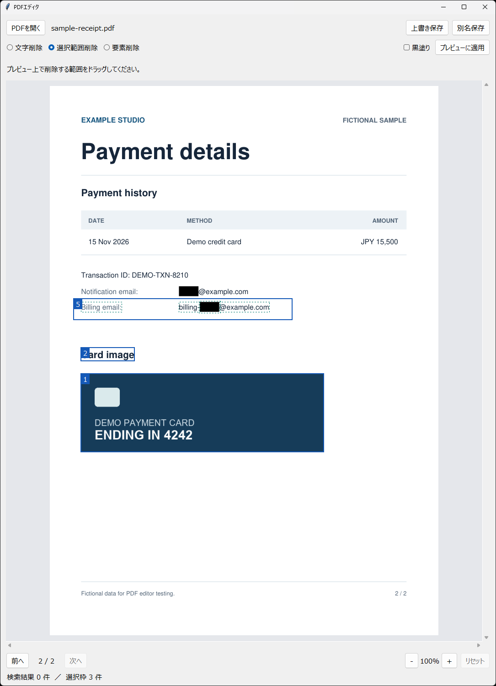

# minimal-pdf-editor (information redaction)

> [!NOTE]
> 自分用にCodexに作らせたものですが、とりあえず公開します。

PDFで表示したくない情報を削除するための最小限のPDF編集ツール。  
PDFから、検索した文字列やマウスで選んだ要素・範囲を削除か黒塗りにする。

## Requirements

- uv (Python/Package Manager)

## Setup

```sh
uv sync
```

## Run

```sh
uv run pdf-editor
```

## Screenshot


## License
This project is licensed under the MIT License. See the [LICENSE](LICENSE) file for details.
